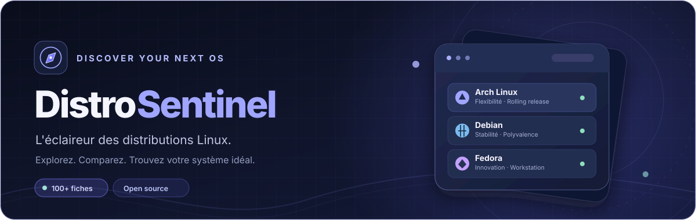
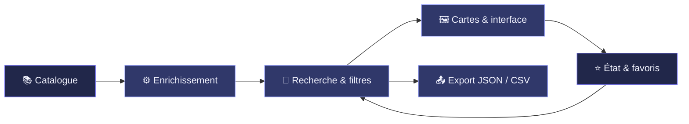
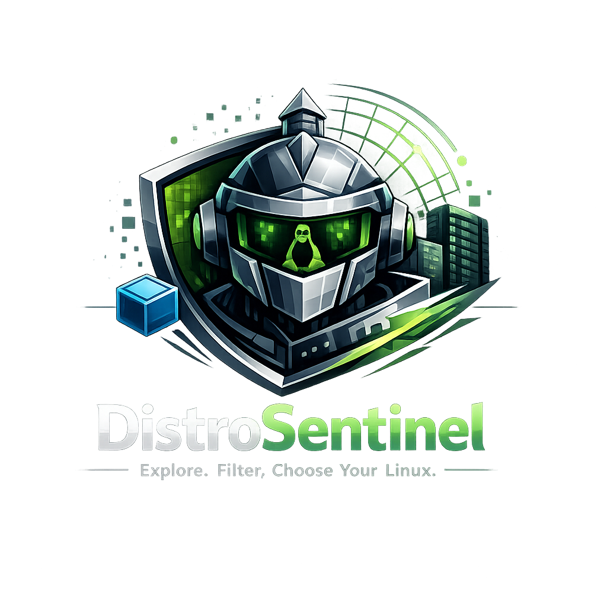

<div align="center">



<br />

**Le bon système pour le bon usage. Sans parcourir vingt comparatifs.**

Un explorateur de distributions Linux, BSD et systèmes apparentés, pour découvrir leurs atouts, comprendre leurs compromis et trouver celle qui vous correspond.

<br />

[](https://github.com/neosoda/DistroSentinel/stargazers)
[](https://github.com/neosoda/DistroSentinel/commits/main)
[](https://www.typescriptlang.org/)
[](https://vite.dev/)
[](#-déploiement-docker)

<br />

[**Découvrir les fonctionnalités**](#-ce-que-vous-pouvez-faire) · [**Démarrer**](#-démarrage-rapide) · [**Déployer**](#-déploiement-docker) · [**Contribuer**](#-contribuer)

</div>

---

## ✨ Découvrez Linux autrement

Il existe des centaines de systèmes et de variantes. Entre les distributions grand public, les systèmes immuables, les environnements de sécurité, les distributions légères ou celles dédiées aux serveurs, difficile de savoir par où commencer.

**DistroSentinel** rassemble **plus de 100 fiches** dans une interface pensée pour aider à choisir, pas simplement pour afficher une liste.

Chaque fiche met en perspective les **points forts**, les **limites**, les **usages recommandés** et les informations essentielles, avec un accès aux ressources de téléchargement et à l'essai en ligne lorsque celui-ci est proposé par DistroSea.

### 🎯 Ce que vous pouvez faire

| | Fonctionnalité | À quoi ça sert |
| :--: | --- | --- |
| 🔎 | **Recherche intelligente** | Retrouvez une distribution avec une recherche tolérante, portant aussi sur ses caractéristiques et usages. |
| 🧭 | **Filtres combinables** | Affinez par famille, niveau de difficulté et centres d'intérêt. |
| 🧩 | **Tags AND / OR** | Recherchez des systèmes répondant à *tous* vos critères ou à *au moins un*. |
| 🖥️ | **Vues spécialisées** | Passez d'un catalogue général à une sélection orientée **IT Pro** ou **Éducation**. |
| ⭐ | **Favoris persistants** | Marquez vos distributions et retrouvez-les au prochain passage, dans le même navigateur. |
| ⚖️ | **Forces et compromis** | Consultez les avantages, limites et publics ciblés de chaque système. |
| 🚀 | **Essai et téléchargement** | Accédez aux pages de téléchargement et à une recherche sur **DistroSea**, dans un nouvel onglet. |
| 📤 | **Export JSON / CSV** | Exportez le catalogue complet ou seulement les résultats filtrés. |
| 🌗 | **Thèmes clair et sombre** | Choisissez une interface confortable ; votre préférence reste mémorisée. |

> [!TIP]
> **Vous découvrez Linux ?** Commencez par le niveau *Débutant* et les usages qui vous intéressent. **Vous gérez une infrastructure ?** Essayez la vue *IT Pro* et les filtres *Serveur* ou *Sécurité*.

---

## 🧪 Pour tous les profils

<table>
  <tr>
    <td width="33%" valign="top">
      <h3>🌱 Découverte</h3>
      Identifiez une distribution accessible pour la bureautique, la maison ou un premier passage à Linux.
    </td>
    <td width="33%" valign="top">
      <h3>🛠️ Admins & DevOps</h3>
      Repérez les systèmes adaptés aux serveurs, à l'infrastructure, au réseau ou aux environnements techniques.
    </td>
    <td width="33%" valign="top">
      <h3>🎮 Passionnés</h3>
      Explorez les distributions orientées gaming, performance, personnalisation ou matériel peu puissant.
    </td>
  </tr>
</table>

**Familles disponibles :** Debian · Arch · RPM · BSD · Indépendantes

**Usages proposés :** Gaming · Serveur · Sécurité · Léger · Création · Éducation · Immutable · Embarqué · Performance

**Tris proposés :** pertinence · nom · difficulté · famille

<details>
<summary><strong>Comment fonctionne le classement ?</strong></summary>

La recherche calcule un score de pertinence à partir des noms, bases, usages et informations enrichies de chaque fiche. Les résultats sont ensuite filtrés selon votre sélection puis ordonnés selon le tri choisi.

Les familles, niveaux, tags et recommandations sont issus des données du catalogue et de règles d'enrichissement : ce sont des **indications d'aide à la découverte**, pas des benchmarks ou des évaluations indépendantes.

</details>

---

## 🚀 Démarrage rapide

**Prérequis :** Node.js compatible avec Vite 8 et npm.

```bash
git clone https://github.com/neosoda/DistroSentinel.git
cd DistroSentinel
npm ci
npm run dev
```

Ouvrez ensuite l'adresse indiquée dans le terminal (généralement **http://localhost:5173**).

### Autres commandes

```bash
npm run build      # Génère la version de production dans dist/
npm run preview    # Prévisualise le build localement
```

> Le catalogue et ses filtres fonctionnent côté navigateur : aucun serveur applicatif ni base de données ne sont nécessaires pour consulter les fiches.

---

## 🐳 Déploiement Docker

Le dépôt fournit un **Dockerfile multi-stage** : Vite construit les assets, puis Nginx sert les fichiers statiques sur le port **3000**.

```bash
docker build -t distrosentinel .
docker run -d \
  --name distrosentinel \
  --restart unless-stopped \
  -p 3000:3000 \
  distrosentinel
```

Accédez à **http://localhost:3000**.

### ☁️ Déployer avec Coolify

1. Créez une application depuis ce dépôt GitHub.
2. Sélectionnez **Dockerfile** comme méthode de build.
3. Configurez le **port interne 3000**.
4. Associez votre domaine et lancez le déploiement.

Nginx est déjà configuré pour servir l'application et gérer le fallback SPA ainsi que la compression Gzip.

---

## 🧱 Architecture

Une application légère, sans framework d'interface imposé : **TypeScript + Vite + CSS**, avec un état applicatif centralisé et des fonctionnalités séparées par responsabilité.



<details>
<summary><strong>Explorer la structure du projet</strong></summary>

```text
DistroSentinel/
├── docs/
│   └── hero.svg                 # Bannière du README
├── public/
│   └── logo.png                 # Identité graphique du site
├── src/
│   ├── data/
│   │   ├── rawDistros.ts        # Fiches du catalogue
│   │   └── constants.ts         # Liens et correspondances
│   ├── domain/
│   │   ├── enrichment.ts        # Métadonnées et catégorisation
│   │   └── filter.ts            # Recherche, filtres et tri
│   ├── store/
│   │   └── state.ts             # État, favoris, préférences
│   ├── ui/
│   │   ├── components/Card.ts   # Cartes des distributions
│   │   ├── events.ts            # Interactions utilisateur
│   │   └── render.ts            # Rendu du catalogue
│   ├── utils/
│   │   ├── export.ts            # Exports JSON et CSV
│   │   └── helpers.ts
│   ├── types/
│   └── main.ts                  # Point d'entrée
├── index.html
├── style.css
├── Dockerfile
├── nginx.conf
└── package.json
```

</details>

### Stack

| Couche | Technologies |
| --- | --- |
| Interface | HTML, CSS, TypeScript |
| Build | Vite 8 |
| État | Store réactif léger |
| Persistance locale | Web Storage pour favoris et thème |
| Données | Catalogue TypeScript embarqué |
| Production | Docker multi-stage + Nginx |

---

## 🗂️ Enrichir le catalogue

Vous connaissez une distribution absente ou souhaitez corriger une fiche ?

1. Modifiez les données dans [`src/data/rawDistros.ts`](src/data/rawDistros.ts).
2. Si nécessaire, complétez les URL et correspondances dans [`src/data/constants.ts`](src/data/constants.ts).
3. Vérifiez l'affichage, les filtres et les liens en local.
4. Ouvrez une **Pull Request** avec une explication courte et des sources officielles.

**À privilégier :** descriptions factuelles, avantages et limites équilibrés, liens vers le projet officiel et informations techniques vérifiables.

> [!NOTE]
> Les boutons **Essayer** redirigent vers une recherche sur [DistroSea](https://distrosea.com/) : l'accès à une session dépend du catalogue et de la disponibilité de ce service tiers. Les liens de téléchargement pointent vers les ressources renseignées pour chaque fiche ; vérifiez toujours leur destination avant d'installer un système.

---

## 🤝 Contribuer

Les suggestions, corrections de fiches, améliorations d'accessibilité et contributions à l'interface sont les bienvenues.

[](https://github.com/neosoda/DistroSentinel/issues/new)
[](https://github.com/neosoda/DistroSentinel/pulls)

**Licence :** le [`package.json`](package.json) déclare **ISC**. Aucun fichier `LICENSE` distinct n'est actuellement présent dans le dépôt.

---

<div align="center">



### Trouvez le Linux qui vous ressemble.

**Made with 💜 by [neosoda](https://github.com/neosoda)**

Si DistroSentinel vous est utile, une ⭐ sur GitHub aide à faire découvrir le projet.

[⬆ Retour en haut](#)

</div>
